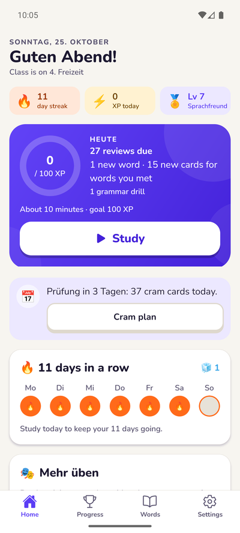
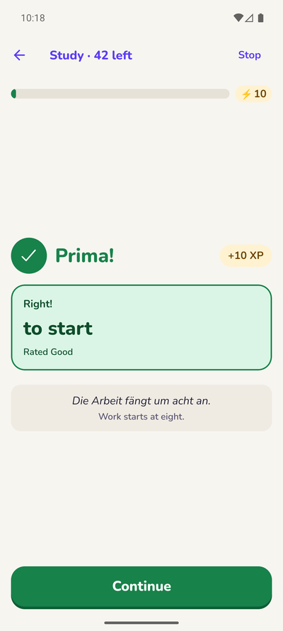
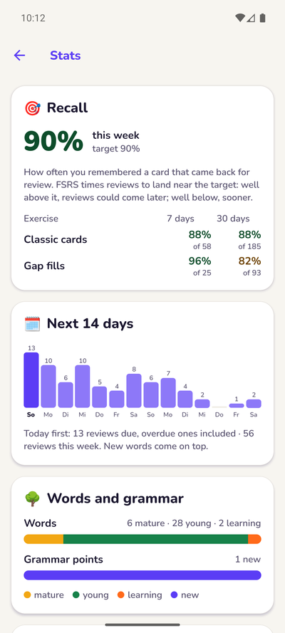
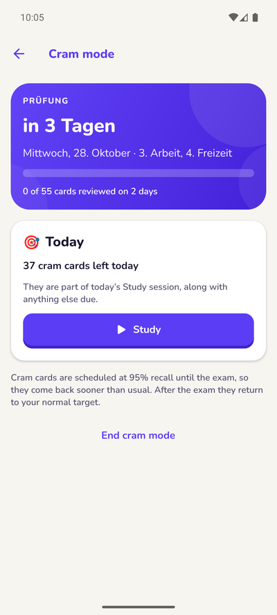
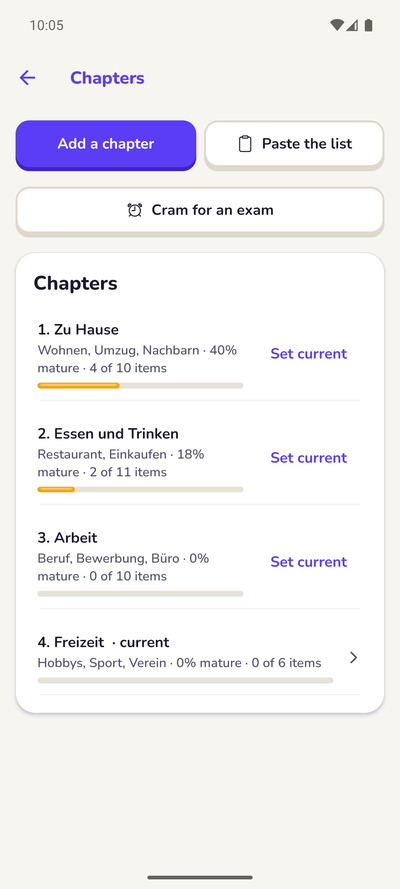
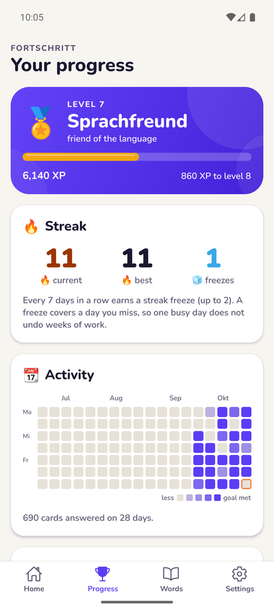
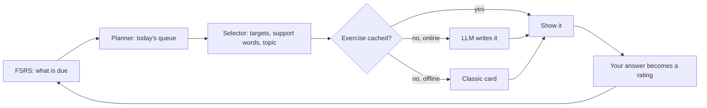
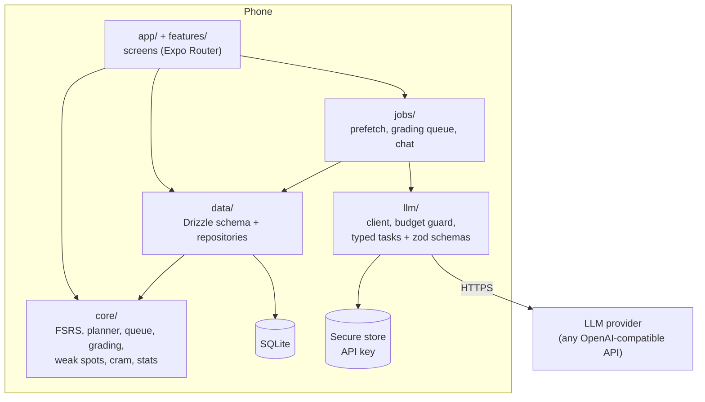

# German Study

A flashcard app for learning the German your class is teaching, at A2 level. It pairs a spaced-repetition scheduler (FSRS) with a cheap LLM, so every review uses a fresh sentence built around the words you are closest to forgetting.

Built with React Native and Expo for one learner. Everything lives on the phone: no accounts, no server, and LLM spend capped at $2 a month.

<p>
  
  
  
  
</p>
<p>
  
  
  
  
</p>

<sub>Screenshots: the release build with a demo deck of a month's study. Stories and chats come from the local mock LLM, so their text is canned.</sub>

## The problem

General language apps follow their own fixed path, so months in you are still drilling *Vater und Mutter* while your class has moved on to A2. Plain flashcards fix the content problem but go stale: the same card with the same example, until you recognise its shape instead of its meaning.

The goal here: study exactly the words and grammar from class, in a new context every time, with the app deciding what comes up and when. One tap starts a 10-minute session that mixes exercise types for you.

## How it works

You paste the vocabulary list from class. The LLM fills in articles, plurals and verb forms, and you check a preview before anything enters the deck. A noun becomes several cards (meaning, gender, plural, production), because forgetting *die* is a different memory from forgetting what *Wohnung* means.

Every day the app builds a queue and runs it as one session:



Only the "LLM writes it" step needs a connection, and it rarely runs during a session: the app generates sentences ahead of time and caches them, so reviews work offline.

## Features

- **Add words fast.** Type one word or paste a whole list in textbook notation (`die Wohnung, -en`, `umziehen, zog um, ist umgezogen`). An offline Wiktionary noun list double-checks the LLM's genders and plurals.
- **A mixed session.** A warm-up of due cards, gap fills for words you are learning, translations for words you know well, grammar drills, then today's new words.
- **Gap fills and translations.** The LLM writes new A2 sentences around your target words. Translations accept any correct German, mark each error and suggest a more natural version. Offline, answers wait and get graded later.
- **Grammar points as cards.** Name a rule such as *Dativ nach mit, bei, von*; the LLM writes a summary and five-item drills.
- **Mini stories and chat roleplay.** A short story around words you know, with underlined words to tap for their English, or a ten-message chat in a scenario where each message you write gets a correction folded under it.
- **Weak spots.** Every mistake gets a category (articles, case endings, word order…). The scores fade over two weeks, the top one pulls its grammar into the next session, and any of them can be drilled in one tap.
- **Leeches and mix-ups.** Cards you keep forgetting get a memory hook; words you confuse, such as *stellen* and *stehen*, come back together.
- **Chapters and cram mode.** Paste the textbook's contents page once. Each chapter shows how much of it is mature. Before an exam, cram mode raises the target recall for its chapters and spreads two reviews of every card over the days left.
- **Stats.** Real recall over 7 and 30 days against your target, split by exercise, a 14-day forecast, minutes per day and LLM spend.
- **Progress without guilt.** XP, a daily goal, streaks with freezes, levels with German titles and badges, all computed from the review log. An optional reminder names the work waiting (*23 reviews and 4 new words*) and stays quiet once you studied.
- **Backups.** Export and import the whole deck as a JSON file. The API key never leaves secure storage.

## The algorithm

### Memory: FSRS

Each card runs [FSRS](https://github.com/open-spaced-repetition/ts-fsrs), the algorithm Anki uses. It tracks a card's stability (how long the memory lasts) and difficulty, and schedules the next review for when the predicted chance of remembering drops to your target recall, 90% by default.

### Today's queue

The planner builds the queue in this order:

1. **Warm-up:** up to 20 due cards as classic cards, oldest due first.
2. **Gap fills:** production cards still learning or young, in generated sentences.
3. **Translations:** one or two mature production cards.
4. **Grammar:** due grammar drills, plus the one your top weak spot pulls forward.
5. **New items:** today's allowance, each introduced before it is asked.

A new word starts with its recognition card. Its gender, plural and production cards unlock the next day, so you meet a word before you are asked to produce it.

The **new-word allowance** adapts: it starts at 10, drops by one for every 10 overdue cards, stays between 0 and 15, and falls to 0 while your recall over the last three days is under 80%. Adding words to a pile you are failing makes both worse.

### Choosing the exercise

How a card is asked follows its maturity:

| Card state | Exercise |
| --- | --- |
| New | Introduced with its example, then a recognition card |
| Learning | Gap fill with the first letter as a hint |
| Young review | Gap fill without hints |
| Mature (stability of 21 days or more) | Translation of an English sentence |

Generated sentences are built in batches. Each holds one target card and up to three **support words**, at-risk ones first: words whose predicted recall drops under 85% within three days. Reading them in context refreshes them without counting as a review. Topics come about 70% from the current chapter's themes and 30% from your interests, and a card never sees the same sentence within its last five exercises.

### From answer to rating

You never grade yourself:

| What happened | FSRS rating |
| --- | --- |
| Wrong, skipped or revealed | Again |
| Right after a hint, or a small slip (*ae* for *ä*, a lowercase noun) | Hard |
| Right | Good |
| Right and clearly faster than your usual time on a review card | Easy |

In stories and chats each target word gets its own rating. Tapping a word in a story counts as a lapse; reading it without help gives no rating, because reading is weaker evidence than producing.

### Weak spots and leeches

Every mistake adds one to its category's score, and scores halve every 14 days without new errors. A card that lapses six times becomes a leech: the LLM writes a memory hook for it, and you can rewrite or suspend it.

### Cram mode

Pick the chapters an exam covers and its date. Until the exam ends:

- Those cards are scheduled at 95% recall, so they come back sooner.
- Each card owes two review days. Every day takes an even share of what is still owed: cards due anyway first, then cards that need a review on every day left, then first reviews before second ones.
- The exam's new words come first and do not stop at the daily allowance.

Twenty cards with five days left come back eight a day, not forty the night before.

### Is it working?

The Stats screen shows **real recall**: answers on cards that came back for review, with the learning steps of new words left out. That is the number FSRS aims at, so it should sit near your target.

`npm run report -- backup.json` goes further. It replays every card through FSRS and, before each review, asks how likely FSRS thought you were to remember. Grouped by that prediction, the share you actually remembered shows whether the default parameters fit you. See [Measuring recall](#measuring-recall).

## Architecture

Everything runs on the phone. The study logic is a pure TypeScript `core` with no React Native imports, so it is unit tested in milliseconds and could move to a server unchanged.



- **Screens read through live queries.** Repositories call `notifyChange` after every write and screens re-run their queries, so the database stays the only source of truth. Each answer is written in its own transaction the moment you give it.
- **The `llm` module is the only code that touches the network.** Every call goes through one client that checks the monthly budget first and logs tokens after. Each task has a versioned prompt and a zod schema; a reply that fails validation is retried once with the error attached, then the app falls back to offline content.
- **`jobs` tops up the cache** when the app opens online and after each session: gap sentences for tomorrow's due and at-risk cards, translations, drills, contrast sets and one story.
- **Progress is never stored.** XP, streaks, badges, stats and the reminder text are all derived from the review log, so a restored backup brings them back exactly.

```
src/
  app/        Routes (Expo Router)
  core/       Pure logic: scheduling, planning, grading, weak spots, cram, stats
  data/       SQLite schema, migrations and repositories
  features/   Screens grouped by feature
  jobs/       Background work: prefetch, grading queue, chat turns
  llm/        Provider adapter, prompts, schemas and cost tracking
  ui/         Shared components and theme
scripts/      Mock LLM server, noun list builder, recall report
.maestro/     End-to-end flows
```

| Concern | Choice |
| --- | --- |
| App | Expo SDK 57, React Native, Expo Router, TypeScript strict |
| Storage | SQLite (`expo-sqlite`) with Drizzle ORM and its migrations |
| Scheduling | [ts-fsrs](https://github.com/open-spaced-repetition/ts-fsrs) |
| Validation | zod, for LLM output and backups |
| LLM | Any OpenAI-compatible API: OpenAI, DeepSeek, OpenRouter or a custom URL |
| Tests | Jest (logic on sql.js), React Native Testing Library, Maestro |

## Getting started

You need Node.js 22 or newer and the [Expo Go](https://expo.dev/go) app for SDK 57, an Android emulator or an iOS simulator.

```bash
npm install
npm start
```

Scan the QR code with Expo Go, or press `a` for Android or `i` for iOS.

### Connecting an LLM

Open **Settings**, pick a provider and paste your API key. It is stored in the phone's secure storage and only ever sent to that provider. Enter the model's price per million tokens and the app tracks month-to-date spend against the cap.

To try everything without a key or any cost, run the local mock server:

```bash
node scripts/mock-llm-server.js
```

Then choose **Custom** in Settings with base URL `http://10.0.2.2:8787/v1` (Android emulator), model `mock-mini` and key `test-key`.

## Testing

```bash
npm run ci
```

runs the type check, lint, format check and every Jest test, the same as CI on each push. Logic tests run the real repositories against an in-memory SQLite (sql.js) with the real migrations; screen tests render screens with React Native Testing Library.

### End-to-end tests

The [Maestro](https://maestro.mobile.dev) flows in `.maestro/` drive the release build on an emulator: adding a word, pasting a list and studying it, and exporting a backup. They start from a fresh install and use the mock LLM.

```bash
node scripts/mock-llm-server.js
maestro test .maestro
```

## Building a release APK

The app uses Expo's continuous native generation, so `android/` is generated, not committed.

```bash
npx expo prebuild --platform android
cd android
./gradlew assembleRelease
```

The APK lands in `android/app/build/outputs/apk/release/`. It is signed with the debug key, which is fine for installing on your own phone. With an Expo account, `eas build --platform android --profile preview` builds the same APK in the cloud.

On Windows, native builds need short paths:

- Keep the Android SDK at a path without spaces, or point `sdk.dir` in `android/local.properties` at a junction to it (`mklink /J C:\android-sdk "%LOCALAPPDATA%\Android\Sdk"`). When CMake shortens a path with spaces to its 8.3 name, clang stops linking the C++ runtime.
- Build from a short folder such as `C:\dev\german-study`. From a deep folder, some CMake paths under `node_modules` pass 260 characters, and the ninja the SDK bundles cannot read them: the build ends in "build.ninja still dirty after 100 tries".

## Measuring recall

After a few months of real use, export a backup and run:

```bash
npm run report -- german-study-backup.json > report.md
```

It prints days studied, answers and time, real recall per month and per exercise against the target, how well FSRS predicted your recall, the deck's maturity and LLM spend. Add `--since 2026-08-01` to cover one period.

## Status

Every roadmap phase is built: the deck and scheduler, fresh content, production and grammar, stories and chat, stats and class sync, and end-to-end tests with a release build. Still ahead: a write-up of real recall numbers once there are three months of them, and audio through on-device text-to-speech.

Noun genders and plurals for the offline check come from Wiktionary via the [german-nouns](https://github.com/gambolputty/german-nouns) list (CC BY-SA 4.0).
